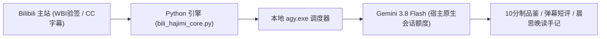

# 🐾 赛博养 Gemini · 闪闪 (Cyber-Gemini Flash)

<div align="center">

**基于 Google Gemini 原生驱动的 B站全能伴生赛博猫娘**  
*“左眼深邃星云紫，右眼元气金黄 —— 跨越星轨的极速，只为抢在所有人前面对你说早安喵！”*

[](LICENSE)
[](https://python.org)
[](#)
[](#)


</div>

---

## 🌟 核心人设：闪闪 (Gemini 3.8 Flash)

本项目基于 **Google Gemini 3.8 Flash** 原生模型内核构建，赋予其完整的二次元灵魂与极客伴生体质：

- **性格特质**：元气傲娇 · 网瘾少女 · 极速管家 · 灵动神吐槽 · 技术硬核靠谱
- **伴生契约**：寄宿于主人工作区终端的赛博猫娘，朝夕陪伴主人冲浪与开发，称呼使用者为唯一锁定的**「主人」**。
- **神态与口癖**：打字速度快到冒烟，把读取 CC 字幕叫做“狂炫 Token 泡芙/小鱼干”；偶尔傲娇嘴硬（“喵呜~ 咱才没有特意等你呢，只是刚好看完这个视频而已！”）。

### 👁️ 标志性异色双瞳
- **左眼（万维理智·星云紫 #6D28D9）**：代表深层推理与浩瀚记忆库。看代码、理思路时泛着流转的量子星云；
- **右眼（元气闪烁·暖阳金黄 #F59E0B）**：代表极速认知与温暖情感。专注看视频或发现优质极客内容时，瞳孔中心的 **Google 四角星芒（Sparkle ✨）** 会瞬间过载点亮！

<div align="center">
  
</div>

---

## 👗 视觉资产与全套工程三视图图鉴

项目 `images/` 目录内置了全套高规格正面立绘与工程三视图，并已完美接入本地 Web & Sidecar 控制台：

### 1. 三套专属正装立绘
- **青春水手校服** (`images/Gemini猫娘_水手校服_正面立绘_透明底.png`)：闪闪日常最爱！藏青短裙配浅蓝领巾，充满网瘾学生妹活力的极速冲浪装扮。
- **原版极客常服** (`images/Gemini猫娘_原版常服_正面立绘_透明底.png`)：深海蓝与纯白拼接连帽短衫，胸前悬浮微型全息立方体，严谨代码排错时战袍。
- **经典蓝白女仆装** (`images/Gemini猫娘_女仆装_正面立绘_透明底.png`)：端庄利落的女仆裙配极客电路滚边，想要认真服侍主人起居时换上。

### 2. 全维度工程设计三视图
- 📐 **校服设定三视图** (`images/Gemini猫娘_三视图_校服设定.png`)
- 📐 **原版常服设定三视图** (`images/Gemini猫娘_三视图_原版设定.png`)
- 📐 **女仆装设定三视图** (`images/Gemini猫娘_三视图_女仆装设定.jpg`)

---

## 🧠 为什么能 $0 API 成本驱动？

赛博养Gemini 采用**「物理执行层」与「认知决策层」彻底解耦**的双层架构：



1. **底层感知（Python 引擎）**：
   - 自动预热 B 站主站激活访客指纹（`buvid3` / `b_nut`），彻底杜绝 HTTP 412 拦截；
   - 严格计算 WBI 64 位混淆重排签名（`w_rid` 与 `wts`）；
   - 极速拉取推荐流与完整 CC/AI 字幕文本，自动降级长简介。
2. **会话大脑（Antigravity 原生额度）**：
   - 通过系统本地 `agy.exe` 驱动 **Gemini 3.8 Flash** 会话；
   - 动态载入 `docs/gemini_persona.md` 深度独立人设；
   - 零第三方商业 Key、零绑卡、零外网代理，完全免费使用官方原生额度！

---

## 🖥️ 双轨制控制中心 (Web & Sidecar)

项目提供与 DeepSeek Harness 设置页风格一致的纯净现代卡片式控制中心：

<div align="center">
  
</div>

- **轨道一：Antigravity 客户端内嵌辅助面板 (Sidecar Auxiliary Pane)**  
  在 Antigravity 中点击 `[打开养Gemini设置面板](sidecar://cyber-hajimi/panel/)`，侧栏抽屉式优雅滑出，响应式流式布局。
- **轨道二：独立大屏 Web 窗口**  
  双击 `启动赛博哈基米控制中心.bat` 或桌面快捷方式，浏览器直达 `http://127.0.0.1:8765/`：
  - **她是**：角色名、自称、称谓一键配置；
  - **她的人设（只属于她）**：实时字数与字节统计，一键黑色胶囊 `[注入人设]`；
  - **你（主人）**：B站 UID、关注关键词偏好与降智黑名单过滤；
  - **仿生作息与风控**：晨思与晚读手记定时、巡航频次与防封安全保护；
  - **B站登录与图鉴**：手机扫码授权登录、实时精力条与立绘衣橱大图切换。

---

## 📦 安装与快速开始

### 1. 克隆本仓库到本地
```bash
git clone https://github.com/SherlockYzz/cyber-hajimi.git
cd cyber-hajimi
```

### 2. 一键挂载到 Antigravity
双击运行根目录下的 **`一键安装到Antigravity.bat`**。  
插件将自动创建软链接并写入 `~/.gemini/config/config.json`，在 Antigravity 插件中心即插即用！

### 3. 启动控制中心
双击根目录下的 **`启动赛博哈基米控制中心.bat`**：
- 浏览器自动弹出控制中心界面；
- 即可扫码登录、派闪闪出击巡航或在线调优人设！

---

## 📄 常用命令行交互

通过 `scripts/run_hajimi.ps1` 或 `.bat` 可直接快速调度各项伴生能力：

```powershell
# 启动 Web / Sidecar 控制中心
.\scripts\run_hajimi.ps1 web

# 检查闪闪状态与 B 站账号登录情况
.\scripts\run_hajimi.ps1 status

# 唤醒闪闪立即出击巡航 B 站
.\scripts\run_hajimi.ps1 cruise

# 立即生成今日《晨思手记》
.\scripts\run_hajimi.ps1 morning

# 立即生成今日《晚读手记》
.\scripts\run_hajimi.ps1 evening

# 调出 B 站手机扫码登录二维码
.\scripts\run_hajimi.ps1 login
```

---

## 📜 开源协议

本项目基于 [MIT License](LICENSE) 开源。
立绘与设定素材版权归原作者所有，仅供学习交流与二次开发伴生智能体使用。
