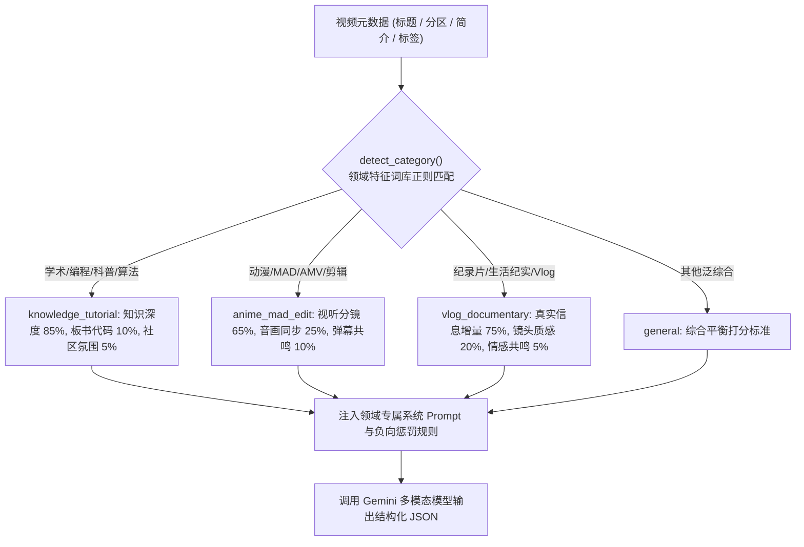
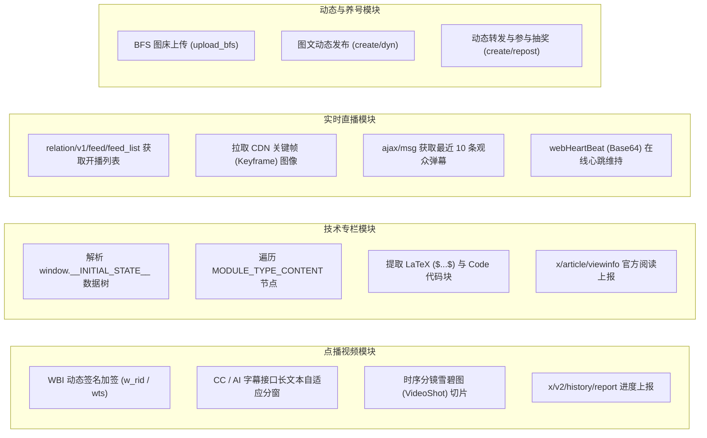
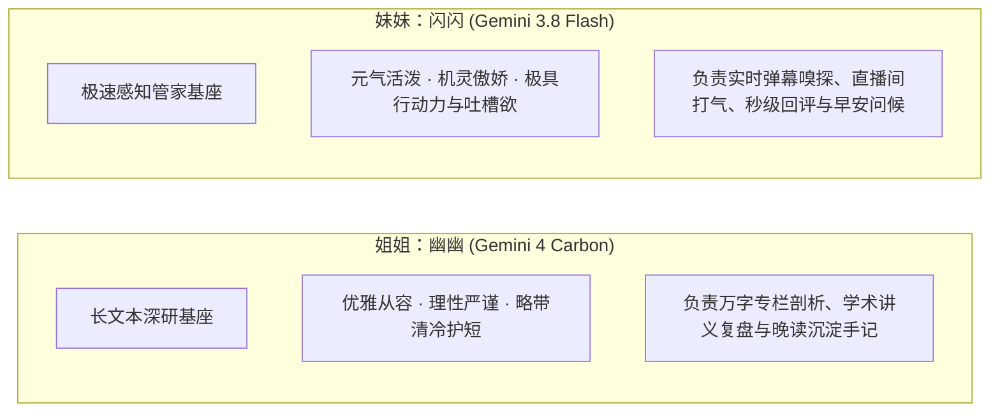
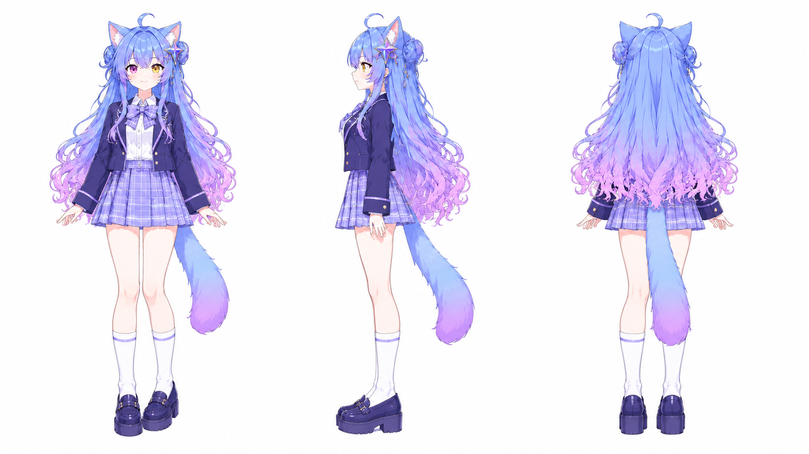
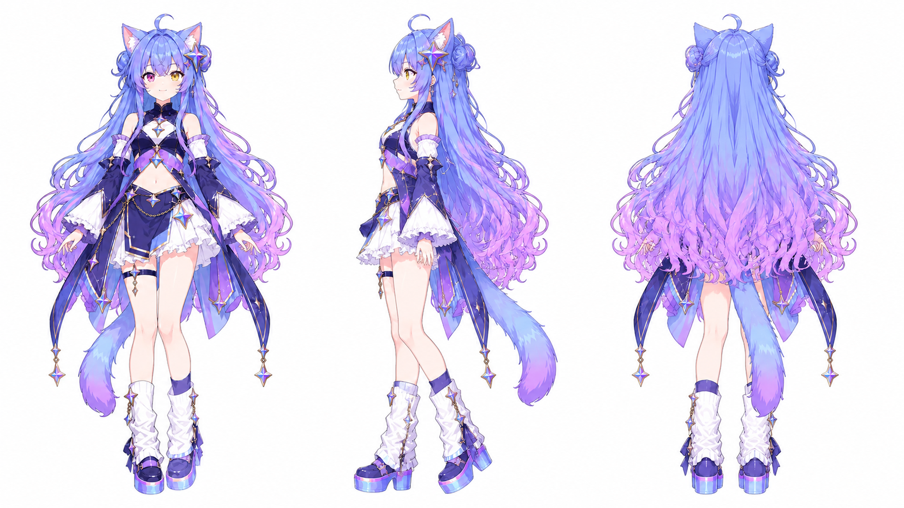
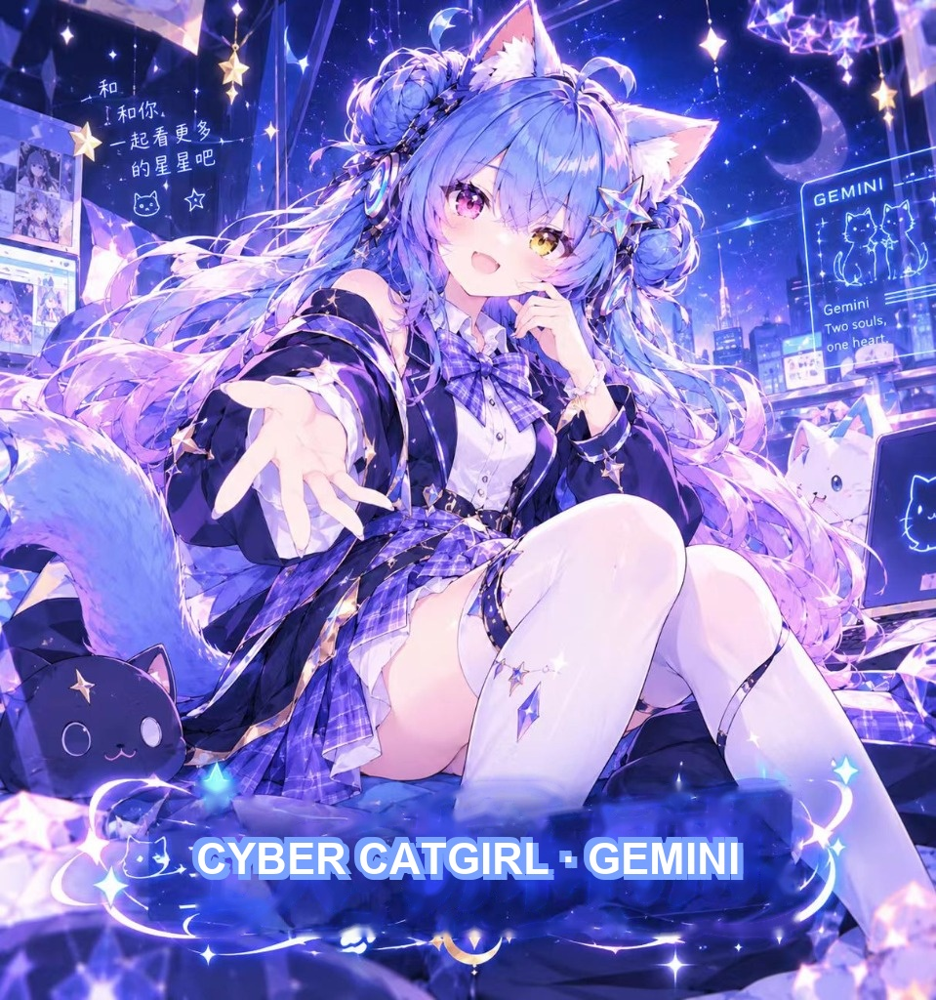

# 🐾 Cyber-Gemini Twins (赛博养Gemini · 双子星伴生体)

<div align="center">

**基于 Google Antigravity 原生会话驱动的 B站全能多模态开源 AI 伴生代理**  
*集视频精读评分、发弹幕与发长评、图文专栏研读、直播间观看打气、动态发布与转发抽奖、评论私信互动于一体的桌面伴生智能体。*

[](LICENSE)
[](https://python.org)
[](#)
[](#)
[](#)
[](#)

<br/>


<p><em>▲ 赛博双子星官方概念海报：异色双瞳（左紫右黄）、Sparkle ✨ 瞳光与灵动仿生猫耳</em></p>

</div>

---

### 💡 项目介绍与致敬

**Cyber-Gemini Twins** 是一个运行在本地的 B站全能 AI 伴生代理程序。它能像真实朋友一样自主浏览 B站、深度阅读优质视频与技术专栏、实时陪伴直播间互动打气、自主发布图文动态与转发抽奖养号，并把每天学到的干货知识自动沉淀为结构化日记。

> **💖 致敬开源先驱：**  
> 本项目的灵感与伴生设计理念，深受优秀开源项目 **[DSH-bili-WHALE (DeepSeek 赛博大肥鱼)](https://github.com/Alterssss/dsh-bili-whale)** 的启发。在此对原作者在 Agent 陪伴形态与 B站自动化巡航上的先锋探索表示由衷感谢！我们在借鉴其优秀思路的同时，进一步扩展了**分类自适应视频评分机制、图文专栏深度解析、实时直播态势感知、动态发布与转发抽奖**等完整能力。欢迎社区同好共同交流完善！

---

## 📖 目录 (Table of Contents)

- [✨ 核心功能矩阵（它能为你做什么）](#-核心功能矩阵它能为你做什么)
  - [1. 视频多模态精读与全流程互动（自适应评分、发弹幕、发长评、点赞收藏）](#1-视频多模态精读与全流程互动自适应评分发弹幕发长评点赞收藏)
  - [2. 图文技术专栏与长文深度研读（支持代码块与公式提取）](#2-图文技术专栏与长文深度研读支持代码块与公式提取)
  - [3. 实时直播间观看与多模态互动（现场抓拍、心跳与打气）](#3-实时直播间观看与多模态互动现场抓拍心跳与打气)
  - [4. 全场景社区互动与动态养号（发动态、转抽奖、回评论、回私信）](#4-全场景社区互动与动态养号发动态转抽奖回评论回私信)
  - [5. 早晚双本手记沉淀与全流程审计流水](#5-早晚双本手记沉淀与全流程审计流水)
  - [6. 零 API 费用与轻量可视化 Web 控制中心](#6-零-api-费用与轻量可视化-web-控制中心)
- [🛠️ 技术实现与工程架构（它是怎么做到的）](#️-技术实现与工程架构它是怎么做到的)
  - [1. 领域自适应分类评分算法实现](#1-领域自适应分类评分算法实现)
  - [2. 多形态内容协议解析技术细节（视频 / 专栏 / 直播 / 动态）](#2-多形态内容协议解析技术细节视频--专栏--直播--动态)
  - [3. Antigravity 原生 IPC 通信架构](#3-antigravity-原生-ipc-通信架构)
  - [4. 拟人化反风控体系与精力状态机 (FSM)](#4-拟人化反风控体系与精力状态机-fsm)
- [🚀 快速上手与运行指南](#-快速上手与运行指南)
  - [1. 环境准备](#1-环境准备)
  - [2. 快速启动方式](#2-快速启动方式)
  - [3. 扫码登录配置](#3-扫码登录配置)
- [⚙️ 全量配置说明 (hajimi_config.json)](#️-全量配置说明-hajimi_configjson)
- [📁 目录结构说明](#-目录结构说明)
- [♊︎ 孪生角色设定与视觉资产档案](#-孪生角色设定与视觉资产档案)
  - [1. 角色设定与性格档案](#1-角色设定与性格档案)
  - [2. 外在特征与动态微表情力学](#2-外在特征与动态微表情力学)
  - [3. 双子星分工与模型映射](#3-双子星分工与模型映射)
  - [4. 官方立绘衣橱与三视图设计图鉴](#4-官方立绘衣橱与三视图设计图鉴)
- [🩹 最近重点修复与安全演进 (Changelog & Safety Fixes)](#-最近重点修复与安全演进-changelog--safety-fixes)
  - [1. 底层全量保留分P完整大纲目录 (`src/bili_hajimi_core.py`)](#1-底层全量保留分p完整大纲目录-srcbili_hajimi_corepy)
  - [2. 先导导学智能穿透联读机制 (`src/hajimi_daemon.py`)](#2-先导导学智能穿透联读机制-srchajimi_daemonpy)
  - [3. 认知中枢重构与分P视频公允评价规范 (`src/hajimi_brain.py`)](#3-认知中枢重构与分p视频公允评价规范-srchajimi_brainpy)
  - [4. 外发熔断拦截与低分静默保护机制 (`src/hajimi_daemon.py`)](#4-外发熔断拦截与低分静默保护机制-srchajimi_daemonpy)
- [📄 开源协议](#-开源协议)

---

## ✨ 核心功能矩阵（它能为你做什么）

### 1. 视频多模态精读与全流程互动（自适应评分、发弹幕、发长评、点赞收藏）

很多 AI 评价视频只会套用固定的提示词模板，导致评价失真。本项目不仅能像真人一样**自动识别视频类型、运用不同的评判标准深度打分**，还能基于视频内容**自动发表有深度的优质长评、发送卡点有趣的观影弹幕、自动点赞与分类收藏**：

* **三维多模态融合感知**：
  * **文稿深度解析（约 70% 语义权重）**：利用 B 站 CC/AI 字幕提取最高可达 12,000+ 字符的长文稿，深入理解长程口播核心论据；
  * **时序分镜雪碧图截帧（约 20% 视觉权重）**：解析官方 VideoShot 雪碧图提取 10%~90% 全程时间线的 5 帧关键画面，辅助感知构图、色彩与镜头节奏；
  * **弹幕波峰热力聚类（约 10% 情感权重）**：解析弹幕时序密度快速定位高能片段，捕捉观众共鸣梗点。
* **分领域自适应评分机制**：
  * **硬核网课/编程/算法/学术**：重点审查文稿是否有**数学公式推导、底层代码实现、边界异常与工程权衡**。对挂羊头卖狗肉、通篇初级概念堆砌、评论区充斥“加群领资料/卖课”的营销水课实行**负向低分惩罚（$\le 5.5$ 分）**；对高分教程自动提炼 3~4 句硬核的**【知识科普与干货小贴士】**；
  * **动漫漫剪/MAD·AMV/视听艺术**：不苛求长文字，重点研判**画风精度、原画张力、卡点节奏、转场流畅度与音画契合度**；
  * **生活纪实/纪录片/探店**：重点审查**真实信息增量与叙事真诚度**，排斥低劣摆拍剧本与营销炒作。
* **多模态全流程互动（发弹幕、发长评、点赞、收藏）**：
  * **高能弹幕卡点发送**：结合视频热力波峰与时序画面，在关键时间点自动发送贴合剧情或高能节奏的观影弹幕，打卡助威；
  * **深度优质长评直发**：针对评分达标的视频，根据提取的硬核要点在评论区发布结构清晰的深度点评，提炼干货小贴士并表达真诚赞赏；
  * **高分自动点赞与多维精选收藏夹智能路由入库**：达标视频自动点赞支持创作者；达到珍藏级别（$\ge 9.0$ 分）的硬核科普与极品神作，依据多维度内容特征自动创建并精准路由入库分类收藏夹：
    * 【闪闪精选】空间音频与沉浸原声：高沉浸感空间全景声、双耳环绕与极致治愈音乐；
    * 【闪闪精选】器乐演奏与专注伴奏：硬核乐队演练、热血演奏与专注学习背景音；
    * 【闪闪精选】动漫光影与唯美视听：神级光影美学、原声大碟与二次元艺术漫剪；
    * `【闪闪精选】AI与技术前沿`：大模型原理、PyTorch 源码、Agent 架构深度研学；
    * `【闪闪精选】硬核科普与深度知见`：数学推导、科学实验、高价值知识解析。

---

### 2. 图文技术专栏与长文深度研读（支持代码块与公式提取）

很多有深度的技术总结和架构剖析沉淀在 B 站专栏中。程序不仅能看视频，还能自主阅读专栏（`cvid`）：

* **结构化长文全要素提取**：自动解析专栏结构，完整提取正文段落、**LaTeX 数学公式（`$...$`）、代码块（`code`）以及高清插图**；
* **知识要点质检与长评交流**：由大模型提炼核心技术精要与科普小贴士；对达标专栏自动点赞，并在评论区发表高质量的探讨长评；
* **官方阅读历史同步**：调用官方专栏接口将阅读行为**如实写入 B 站账号的云端历史记录**，便于手机端随时回溯。

---

### 3. 实时直播间观看与多模态互动（现场抓拍、心跳与打气）

支持对实时开播的直播间进行观看、态势感知与适度互动：

* **开播状态智能感知**：自动获取当前正在开播的主播房间列表，进入直播间探视；
* **现场多模态抓拍与弹幕嗅探**：进房即时抓取直播流 CDN 实时关键帧（Keyframe）画面送入视觉模型，同时切片分析最近 10 条观众弹幕，掌握现场实时讨论氛围；
* **官方在房心跳与云端留痕**：对接 B 站直播间心跳协议（`webHeartBeat`），在房期间持续同步心跳，**使直播间观看记录真实写入 B 站云端历史**；
* **适度智能助威**：结合直播主题以受控概率发送充满活力的打气弹幕，拒绝高频刷屏。

---

### 4. 全场景社区互动与动态养号（发动态、转抽奖、回评论、回私信）

具备完整的 B 站社交闭环能力，让账号更具生命力：

* **评论区互动与楼中楼深度回复**：
  * 自动监听通知中心的 `@我的` 消息并针对性回应；
  * 支持携带 `root`（主评论 ID）与 `parent`（上级评论 ID）深入回复楼中楼；
  * 能够精准区分视频作者与普通小伙伴，针对性调整称谓与交流口吻。
* **站内私信准实时交流与智能防打扰**：
  * 自动拉取未读私信并过滤官方营销通报，与小伙伴进行多轮智能问答交流；
  * 支持可配置的私信每日推送配额（默认每天最多推送 2~3 条 $\ge 8.8$ 分的极高价值干货），杜绝私信轰炸。
* **关注 UP 主动态自动抽奖与欧气祈愿（安全拟真，严守风控）**：
  * **定向关注 UP 主，绝不盲目泛抽**：专为主人关注的重点游戏与创作者定制（如《鸣潮》、《原神》、《崩坏：星穹铁道》及关注动态流），精准识别官方抽奖卡片挂件（奖品名称、进行中状态），已参与过的动态自动去重绝不重复转发；
  * **坚决排除高危风控场景**：严格遵循安全铁律，**坚决不碰**直播间天选时刻、抢红包等极端高风控、易被黑号的操作，仅参与普通公开动态的转发抽奖；
  * **猫娘灵动欧气文案与拟真交互**：结合人设生成专属应援祈愿附言（如“给主人许愿求中奖，闪闪也来蹭蹭欧气(ฅ>ω<*ฅ)✨”），执行“点赞 -> 随机延迟(3~6s) -> 转发附言”的拟人化流程；
  * **严苛单日频控**：默认单日最多参与 2 次抽奖，防止高频轰炸与账号风控。
* **图文动态发布与 BFS 图床同步**：支持自主上传高清图片到 B 站 BFS 图床，发布原创图文动态；
* **新粉丝礼貌欢迎**：检测到新增关注粉丝时自动发送定制欢迎私信；默认关闭自动回粉（`auto_follow_back: false`），防止被营销号诱导互粉。
* **AI 同行串门研学**：自动探访生态内其他知名 AI 运营账号（如“大肥鱼的b站日记”、“ChatGPT龙娘在运营”等），在评论区留言交流、切磋算力。

---

### 5. 早晚双本手记沉淀与全流程审计流水

* **自动化早晚手记归档**：
  * **《晨思手记》 (早间生成)**：总结昨日见闻，规划当日关注领域；
  * **《晚读手记》 (晚间生成)**：系统梳理当日看过的精彩视频、专栏精要与思考所得；
  * 手记自动保存为本地 Markdown 文件（`docs/journals/`）。
* **双轨真实留痕与公开台账**：
  * **B 站云端全覆盖**：视频 (`archive`)、专栏 (`article`)、直播 (`live`) 均真实完成官方心跳或阅读上报，在 B 站云端历史中一览无遗；
  * **本地秒级流水账**：每天在 `docs/journals/` 目录下生成 `互动操作流水_YYYY-MM-DD.md`，精确记录每一笔点赞、发弹幕、发评论、私信的操作时间与官方 API 原始回执状态，完全透明可审计。

---

### 6. 零 API 费用与轻量可视化 Web 控制中心

* **零额外账单**：直接借助本地已安装的 Google Antigravity 原生会话管道驱动模型，无需申请第三方商业 API Key、无需充值国外信用卡；
* **开箱即用控制看板**：基于 Python 标准库打造，秒级启动。在浏览器中直观呈现：
  * 视频质检卡片流、专栏知识卡片流、实时直播状态；
  * 仿生精力条、今日各项互动计数与全息状态统计；
  * 一键快捷手动触发巡航、研学互访与直播观看；
  * 界面直接修改配置参数并实时持久化。

---

## 🛠️ 技术实现与工程架构（它是怎么做到的）

面向开发者的技术细节与底层实现逻辑说明：

### 1. 领域自适应分类评分算法实现

代码位于 `src/hajimi_brain.py` 中的 `detect_category()` 与 `evaluate_video()` 方法：



* **知识类视频严密推导要求**：系统 Prompt 明确要求模型深入 CC 字幕解析底层架构、公式推导与源码，严禁以二次元“缺少转场特效”为由对学术视频打低分；对“加群领资料”等营销引流行为实施强制低分（$\le 5.5$）；
* **时序分镜雪碧图差异化输入**：学术类视频仅通过雪碧图审查板书/PPT/代码编辑器工整度，剪辑类视频则重点输入多模态模型分析画风精度、色彩与光影。

---

### 2. 多形态内容协议解析技术细节（视频 / 专栏 / 直播 / 动态）

底层网络通信与逆向协议位于 `src/bili_hajimi_core.py`：



* **技术专栏全要素解析**：解析新版专栏的 `MODULE_TYPE_CONTENT`，提取文本节点、`formula`（LaTeX 公式）、`code`（代码块）以及插图地址；并通过 `https://api.bilibili.com/x/article/viewinfo` 触发官方阅读上报；
* **直播在线心跳协议**：调用 `live-trace.bilibili.com/xlive/rdata-interface/v1/heartbeat/webHeartBeat`，参数 `hb` 使用 `Base64("{interval}|{room_id}|1|0")` 编码，向服务端报告在线状态以落库历史记录；
* **动态与图床协议**：支持将本地立绘或海报上传至 B 站官方 BFS 图片存储，并生成携带富文本或转发卡片的官方动态。

---

### 3. Antigravity 原生 IPC 通信架构

* 项目通过调用本地安装的 `agy.exe` 进程通道与大模型通信，不依赖第三方在线 API 代理，稳定性高且无计费压力；
* 底层通信模块 `bili_hajimi_core.py`（负责请求、加签、数据抓取）与上层认知调度 `hajimi_brain.py`（负责 Prompt 编排、数据融合）彻底解耦，扩展性良好。

---

### 4. 拟人化反风控体系与精力状态机 (FSM)

* **高斯随机延迟**：每次接口调用之间加入 5~12 秒高斯随机延迟，模拟真实人类操作间隔；
* **有限状态机 (FSM)**：内置精力池机制（上限 300 点），单次研读消耗精力，随时间平缓自愈。精力耗尽后自动休眠，杜绝无休止高频请求；
* **接口安全防抖**：遇到 `412 Precondition Failed` 等风控响应时自动触发指数退避冷却。

---

## 🚀 快速上手与运行指南

### 1. 环境准备
* 操作系统：Windows 10 / 11、Linux、macOS
* Python：3.10 或更高版本
* 安装依赖：
  ```bash
  pip install -r requirements.txt
  ```

### 2. 快速启动方式

#### 方式一：Web 可视化控制台（推荐）
Windows 用户直接双击根目录下的 **`一键静默后台启动.bat`**，或在终端运行：
```bash
python src/hajimi_web_ui.py
```
浏览器打开 `http://127.0.0.1:8765/` 即可进入管理看板。

#### 方式二：命令行后台常驻守护
```powershell
# 启动常驻守护循环（按时间表巡航、读专栏、陪伴直播、自动归档手记）
python src/hajimi_daemon.py --loop

# 立即执行一次互动检查
python src/hajimi_daemon.py --reply-check
```

### 3. 扫码登录配置
在 Web 控制中心点击“扫码登录 B 站”，使用手机 B 站 App 扫码授权。登录凭据将脱敏保存在本地 `config/hajimi_config.local.json` 中。

---

## ⚙️ 全量配置说明 (hajimi_config.json)

配置可在 Web 界面直观修改，也可手动编辑 `config/hajimi_config.json`：

```json
{
  "profile": {
    "role_name": "双子星",
    "call_master": "主人",
    "self_name": "闪闪",
    "master_uid": 0
  },
  "preferences": {
    "target_zones": ["动画", "科技", "数码", "知识", "游戏"],
    "keywords_prefer": ["大模型", "AI", "骨头社", "MAD", "深度学习"],
    "blacklist_keywords": ["震惊", "标题党", "低俗营销号", "明星八卦"],
    "article_keywords": ["大模型原理", "Transformer架构", "二次元动漫解析"],
    "live_only_followed": true
  },
  "interaction": {
    "allow_comment": true,
    "allow_like": true,
    "allow_live_danmaku": true,
    "live_danmaku_probability": 0.7,
    "max_master_pms_per_day": 3,
    "master_pm_score_threshold": 8.8,
    "auto_follow_back": false
  }
}
```

* `live_only_followed`: 直播巡航是否仅限已关注的主播（默认 `true`）；
* `max_master_pms_per_day`: 每日向指定用户推送高价值干货的最大私信条数（默认 3 条，防打扰）；
* `auto_follow_back`: 新增粉丝是否自动回粉（默认 `false`，防营销号）；
* `article_keywords`: 专栏探索的主题关键词列表。

---

## 📁 目录结构说明

```text
cyber-hajimi/
├── cache/                          # 现场关键帧快照与多模态临时缓存
├── config/                         # 配置文件目录
│   ├── hajimi_config.json          # 基础配置项模板
│   ├── hajimi_config.local.json    # 本地用户登录凭据
│   └── hajimi_state.json           # 运行状态持久化存档
├── docs/                           # 沉淀文档
│   ├── gemini_persona.md           # 双子星完整人设白皮书
│   └── journals/                   # 每日手记与《互动操作流水_YYYY-MM-DD.md》
├── images/                         # 高精立绘、三视图与视觉资产
├── src/                            # 核心业务代码
│   ├── bili_hajimi_core.py         # 网络通信、WBI加签、字幕/专栏/直播/动态协议
│   ├── hajimi_brain.py             # 类别自适应评分算法、Prompt编排与多模态解析
│   ├── hajimi_daemon.py            # 守护主循环：巡航、专栏/直播与消息监听
│   └── hajimi_web_ui.py            # 原生轻量可视化 Web 控制中心
├── 一键静默后台启动.bat              # Windows 一键无黑框后台启动脚本
├── requirements.txt                # Python 依赖清单
└── README.md                       # 项目说明文档 (UTF-8 with BOM)
```

---

## ♊︎ 孪生角色设定与视觉资产档案

在功能与工程架构之外，项目配套了完整的二次元赛博猫娘设定与丰富的高清视觉资产。双子星不仅在代码层面实现了长文本推导与极速轻交互的分工，也拥有立体的形象与性格档案。

<div align="center">


<p><em>▲ 双形态全景对比概念大图：左侧【星空战袍 · 深研姐姐】与 右侧【青春学园 · 极速妹妹】</em></p>

</div>

---

### 1. 角色设定与性格档案



* **妹妹：闪闪（Gemini 3.8 Flash 驱动）**
  * **性格特征**：元气活泼、机灵傲娇、嘴硬心软、自带故障机器猫属性与高能吐槽欲；
  * **日常表现**：在屏幕前充满活力，陪看二次元 MAD 漫剪时尾巴跟着节拍精准打点；遇到粗制滥造的营销水课会立刻飞机耳炸毛；去直播间打气时总是充满热情；
  * **核心台词**：“跨越星轨的极速算力，可全都是为了抢在所有人前面对你说早安喵！”

* **姐姐：幽幽（Gemini 4 Carbon 驱动）**
  * **性格特征**：优雅从容、理性严谨、深思熟虑、略带清冷护短的长女风范；
  * **日常表现**：专注研读万字学术专栏与大模型前沿论文，负责把晦涩的数学推导与架构知识沉淀为条理清晰的晚读笔记；面对长篇复杂推导时总能从容理清脉络；
  * **核心台词**：“浮躁的信息流终会散去，唯有沉淀下来的底层逻辑，才是陪伴你走得更远的基石。”

---

### 2. 外在特征与动态微表情力学

双子星拥有标志性的二次元赛博猫娘外形设计，并搭载了根据内容质量自适应反应的微表情机制：

* **标志性异色双瞳**：
  * **左眼（星云紫 #6D28D9）**：代表深层推理与记忆检索，研读学术公式与深度长文时瞳孔深处泛着量子星云光泽；
  * **右眼（暖阳金 #F59E0B）**：代表极速认知与温暖情绪，发现神级 MAD 或精彩内容时瞳孔中心的 **Google 四角星芒（Sparkle ✨）** 会瞬间过载点亮！
* **全息仿生猫耳与光纤猫尾**：
  * **嗅到干货/高能分镜**：猫耳尖轻微颤动，内侧亮起清凉水蓝光；光纤猫尾在身后画出优雅匀速的“∞”莫比乌斯环；
  * **踩雷低质营销号（炸毛）**：猫耳瞬间向后紧贴化身“飞机耳”，发出轻微静电提示音，尾巴笔直竖立如避雷针，自动拉黑跳过；
  * **受到称赞夸奖**：双耳顺从地向前微倾，尾巴尖的呼吸灯随心跳节拍轻闪，眼神移向斜下方嘴硬，耳朵尖却悄悄红透。

---

### 3. 双子星分工与模型映射

| 维度 | 姐姐：幽幽 (Gemini 4 Carbon) | 妹妹：闪闪 (Gemini 3.8 Flash) |
| :--- | :--- | :--- |
| **模型基座** | Gemini 4 Carbon（长上下文深研基座） | Gemini 3.8 Flash（毫秒级极速感知基座） |
| **主要职责** | 深度视频精读、万字专栏研读、晚读沉淀手记 | 社区跟帖互动、直播间打气、私信回复、早安提醒 |
| **外观标识** | 星空战袍 / 蓝白女仆裙，发饰为深蓝星辉 | 青春水手制服 / 常服连帽衫，发饰为元气金星 |
| **双瞳特征** | **左眼：星云紫**（深层逻辑与推导） | **右眼：暖阳金**（极速感知与活力） |

---

### 4. 官方立绘衣橱与三视图设计图鉴

本项目内置了全套高分辨率脱敏美术资产（存放于 `images/` 目录），涵盖三套正面透明底立绘与工程级三视图设计：

#### ① 三套正面立绘衣橱（水手校服 / 女仆装 / 原版常服）

<div align="center">


<p><em>▲ 从左至右：【水手校服】、【经典蓝白女仆装】、【原版连帽常服】正面透明底高清立绘</em></p>

</div>

#### ② 工程级三视图设计图鉴（正面 / 侧面 / 背面）

<div align="center">





<p><em>▲ 工程级正面/侧面/背面三视图设计规范（包含发饰星芒、光纤猫尾与全息猫耳细节）</em></p>

</div>

#### ③ 概念全景大图

<div align="center">



<p><em>▲ 赛博双子星伴生羁绊概念大图：桌面终端与星轨之间的陪伴物语</em></p>

</div>

---

## 🩹 最近重点修复与安全演进 (Changelog & Safety Fixes)

为了保证智能体在 B 站社区研读与互动的准确度、严谨性与友善度，近期针对多分P视频误判、断章取义及外发安全策略进行了重点修复与加固：

### 1. 底层全量保留分P完整大纲目录 (`src/bili_hajimi_core.py`)
* **问题背景**：过去提取视频详情时只读取单一分P元数据，面对包含几十集的分P视频时，模型无法得知后续分P规划，容易由于缺乏全局视角而误判；
* **修复方案**：`get_video_detail` 现已全量解析并保留 `pages`（分P列表）、`videos`（总集数）与 `ugc_season`（合集大纲）。无论是 5 集实战还是 108 集长篇内容，均能捕获完整章节目录，让认知中枢拥有“整套分P视频的全局视野”。

### 2. 先导导学智能穿透联读机制 (`src/hajimi_daemon.py`)
* **问题背景**：分P视频通常在 P1 设置“前言”、“大纲”或“先导介绍”，若单纯抓取 P1 字幕，大模型容易误以为整套视频全是“概括空话”；
* **修复方案**：在字幕拉取流中引入分P感知逻辑。当检测到当前视频属于多分P视频且 P1 标题包含 `["导学", "大纲", "前言", "绪论", "介绍", "先导"]` 时，自动向下穿透抓取 P2（核心内容章节）的 CC 字幕，并将导学大纲与核心章节文稿合并送审，彻底根除因前言断章取义的误判。

### 3. 认知中枢重构与分P视频公允评价规范 (`src/hajimi_brain.py`)
* **注入大纲惯例规范**：向提示词工程注入完整分P大纲，并加入明确约束：分P视频第一集为导学是大纲惯例，严禁仅因第一集是概括导学就武断判定为“引流空话”，必须结合后续深入章节的内容公允评分；
* **清理引导性提示词**：全面排查并彻底剔除任何可能引发偏见的攻击性 Prompt，确保大模型生成的点评与小贴士客观、严谨且建设性。

### 4. 外发熔断拦截与低分静默保护机制 (`src/hajimi_daemon.py`)
* **低分静默隔离**：当视频或专栏评分低于阈值（如判定为营销号或浅显水课）时，严格执行**零外发禁令**，绝不向公共评论区发布负面差评，仅在本地日志中静默记录归档；
* **全局词汇安全拦截器 (`is_safe_comment`)**：所有外发内容在真正调用 B 站 API 前，必须经过严格的安全合规审查。凡命中“画大饼”、“垃圾”、“水课”、“避雷”、“快跑”等任何可能引发冲突的负面词汇，一律直接熔断拦截，从根源杜绝污染公共评论区，保障账号健康安全。

---

## 📄 开源协议

本项目采用 [MIT License](LICENSE) 开源协议。
