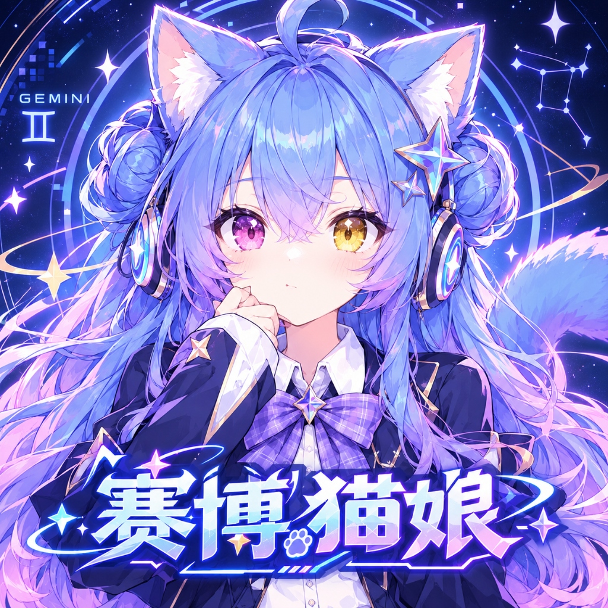
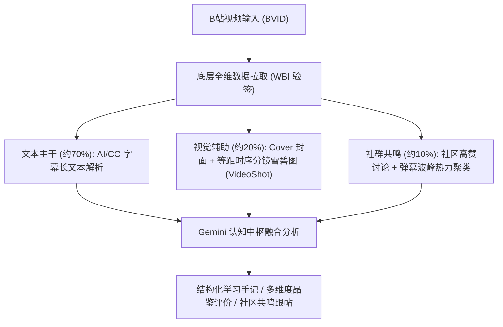
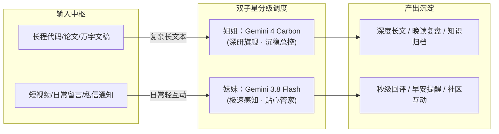
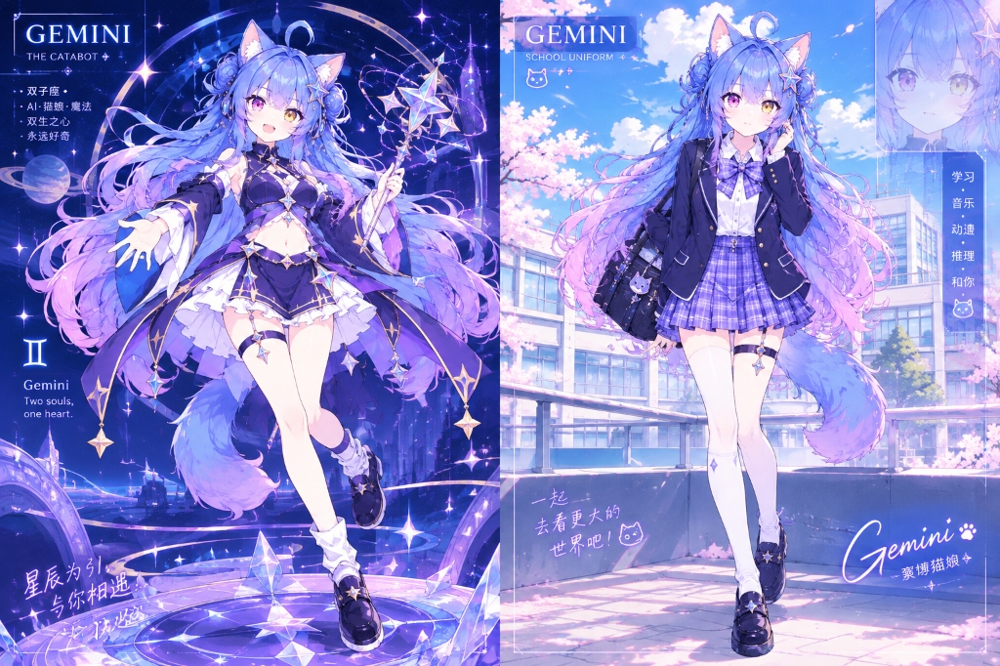

# 🐾 Cyber-Gemini Twins (赛博养Gemini · 双子星伴生体)

<div align="center">

**基于 Google Antigravity 原生会话管道驱动 · 面向 B站生态的多模态开源仿生 AI 伴生代理**  
*“左眼万维星云紫，右眼元气金黄 —— 探索长文本推演与极速感知的双子星伴生形态。”*

[](LICENSE)
[](https://python.org)
[](#)
[](#)
[](#)
[](#)

<br/>



<p><em>▲ 赛博双子星官方概念主海报：标志性异色双瞳（左紫右黄）、Sparkle ✨ 瞳光与灵动天线猫耳</em></p>

</div>

---

### 💡 写在前面：开源致敬与项目初心

本项目是一个面向二次元与极客生态的**开源探索性伴生智能体实验作品**。

> [!NOTE]
> **💖 致敬开源先驱项目：**  
> 本项目的构想与诸多设计思路，深受开源先驱 **[DSH-bili-WHALE (DeepSeek 赛博大肥鱼)](https://github.com/Alterssss/dsh-bili-whale)** 的绝妙启发！  
> 在此对 `DSH-bili-WHALE` 作者在伴生 Agent 美学、B站生态巡航与桌面陪伴体系上的开拓性探索致以由衷的敬意与特别感谢！我们认真学习并借鉴了前辈优秀的架构理念，在此基础上进一步尝试探索了多模态视觉辅助分析与双生人格分工。
>
> ⚠️ **写给各位开发者：**  
> 本项目目前仍处于早期实验与探索阶段，机制与代码多有粗糙与不成熟之处，绝无任何“遥遥领先”之意，纯属个人兴趣驱动的探索性作品。如果代码或机制中有设计不合理、考虑不周到的地方，**恳请各位开发者与社区师傅们批评指正、不吝赐教！** 非常欢迎大家提交 Issue 和 PR 共同探讨、完善！

---

## 📖 目录 (Table of Contents)

- [✨ 核心功能特性（重点新增）](#-核心功能特性重点新增)
  - [1. 科学合理的视频研读机制（70% 文稿 + 20% 分镜 + 10% 社区）](#1-科学合理的视频研读机制70-文稿--20-分镜--10-社区)
  - [2. 全场景社区互动与准实时响应机制](#2-全场景社区互动与准实时响应机制)
  - [3. 零第三方 API 成本：Antigravity 原生 IPC 会话管道](#3-零第三方-api-成本antigravity-原生-ipc-会话管道)
  - [4. 慢速优雅、抗风控的巡航与精力机制](#4-慢速优雅抗风控的巡航与精力机制)
  - [5. 晨思早安与晚读沉淀：双本手记全自动归档](#5-晨思早安与晚读沉淀双本手记全自动归档)
  - [6. 原生轻量 Web 控制中心与 Sidecar 面板](#6-原生轻量-web-控制中心与-sidecar-面板)
  - [7. 关注 UP 主动态抽奖与欧气祈愿（安全拟真，严守风控）](#7-关注-up-主动态抽奖与欧气祈愿安全拟真严守风控)
- [♊︎ 孪生双女主协同架构](#-孪生双女主协同架构)
  - [1. 角色分工与软硬件架构档案](#1-角色分工与软硬件架构档案)
  - [2. 分级协同调度流 (Hierarchical Tiered Dispatching)](#2-分级协同调度流-hierarchical-tiered-dispatching)
- [🎨 视觉资产图鉴](#-视觉资产图鉴)
- [🚀 开发者快速上手与部署](#-开发者快速上手与部署)
  - [1. 环境准备](#1-环境准备)
  - [2. 快速启动](#2-快速启动)
  - [3. 扫码登录与凭据配置](#3-扫码登录与凭据配置)
- [⚙️ 全量配置手册 (hajimi_config.json)](#️-全量配置手册-hajimi_configjson)
- [📁 目录结构](#-目录结构)
- [📄 开源协议与鸣谢](#-开源协议与鸣谢)

---

## ✨ 核心功能特性（重点新增）

### 1. 科学合理的视频研读机制（70% 文稿 + 20% 分镜 + 10% 社区）

很多视频内容（如知识分享、数码评测、动漫杂谈）的核心信息与逻辑链条主要承载于文稿与口播中，单纯靠几张静态截图很难抓住核心主旨；但如果完全脱离画面，又会丧失对画风、镜头节奏与视觉呈现的感知。

因此，本项目探索了一套兼顾信息深度与视觉感知的**复合视频理解工作流**：



* **文稿深度精读为主（约 70% 语义权重）**：  
  利用 B 站 CC 字幕与 AI 字幕接口，完整拉取长程口播文本。让大模型充分发挥长上下文理解优势，精准提炼视频的核心论据、知识干货与逻辑架构，拒绝“看图编故事”。
* **时序分镜画卷辅助（约 20% 视觉权重）**：  
  解析 B 站官方分镜雪碧图（VideoShot）与高清封面，提取视频等间距的关键视觉帧，输入多模态模型辅助感知画面的构图、色彩、镜头节奏与画风质量。
* **社区高赞讨论与弹幕共鸣（约 10% 情感权重）**：  
  抓取评论区前排高赞讨论，结合 XML 弹幕密度聚类高能波峰时段，帮助智能体理解观众的核心梗点与共鸣话题。

---

### 2. 全场景社区互动与准实时响应机制

智能体不再只是单向默默阅读，而是深入参与到主人的互动与社群交流中：

* **评论区互动与留言自动识别**：
  * **主客识别**：精准区分主人与普通小伙伴。当主人在自己或猫娘的视频下留言互动时，以专属亲近口吻高优先级回复；遇到社区普通同好时，以热情机灵的猫娘口吻互动。
  * **楼层深度穿透**：通过 WBI 逆向解析，支持携带 `root`（主评论 ID）与 `parent`（上一级回复 ID）深入楼中楼跟帖回复。
* **@我的通知实时感知**：
  * 轮询监听 B 站通知中心，当有动态或视频 @ 闪闪时，自动提取上下文生成针对性回应。
* **站内私信准实时交流**：
  * 自动拉取最近未读会话，自动过滤 B 站系统官方号与活动通告；
  * 识别主人发来的私信交流并及时回信。
* **15~20 秒拟人化平滑轮询**：
  * 避免高频撞库导致的风控封禁，采用 15~20 秒带有随机抖动的安全轮询节拍，既能做到快速响应主人的留言，又确保账号的绝对安全。

---

### 3. 零第三方 API 成本：Antigravity 原生 IPC 会话管道

* **零 Token 账单与充值**：  
  通过系统本地的 `agy.exe` 驱动原生会话通道，直接调用官方额度处理海量长文本与多模态数据，无需申请第三方商业 API Key、无需海外信用卡充值。
* **架构解耦**：  
  `bili_hajimi_core.py` 专注底层网络数据与 WBI 加密；`hajimi_brain.py` 专注会话管道与提示词编排，职责清晰。

---

### 4. 慢速优雅、抗风控的巡航与精力机制

* **极低频巡航与随机扰动**：  
  日常巡航默认每 15~30 分钟随机巡航一次，单次仅深度学习 1~2 部优质长视频，操作间隔加入 5~12 秒高斯随机延迟，高度拟人化。
* **仿生精力池状态机 (FSM)**：  
  精力上限 100 点，看视频消耗精力（15点/部），随时间平缓自愈（5点/小时）。精力枯竭时自动进入“摸鱼/打盹”状态，拒绝高频无休止爬取。
* **严格播放量门槛过滤**：  
  内置播放量过滤规则（默认仅研读播放量大于 10,000 的内容），自动过滤低质营销号与刷屏内容。

---

### 5. 晨思早安与晚读沉淀：双本手记全自动归档

* **早安《晨思手记》 (07:30~09:30)**：  
  结合昨日学习所得与今日关注领域，生成早安问候与探索规划。
* **晚安《晚读手记》 (22:00~23:30)**：  
  梳理今日看过的精彩视频、汲取的技术知识与灵感反思，以双生姐妹视角生成结构化日记。
* **自动归档**：手记保存于本地 `docs/journals/`，并同步沉淀到产出目录中。

---

### 6. 原生轻量 Web 控制中心与 Sidecar 面板

* **零重型前端框架依赖**：基于 Python 标准库 `http.server` 打造，轻量纯净，秒级启动。
* **配置实时持久化**：在 Web 界面上修改昵称、称谓、偏好标签、黑名单、巡航间隔后，直接持久化写入 `config/hajimi_config.json`，重启不丢失。
* **透明化工作看板**：实时查看猫娘当前精力状态、今日已看视频列表、最近互动记录流水。

---

### 7. 关注 UP 主动态抽奖与欧气祈愿（安全拟真，严守风控）

* **仅限关注 UP 主，绝不盲目泛抽**：
  * 专为主人关注的优质游戏与创作者定制（如《鸣潮》、《原神》、《崩坏：星穹铁道》及关注流中的动态抽奖）；
  * **坚决杜绝高危操作**：完全排除直播间天选时刻、抢红包等极端高风险风控接口，只参与公开动态官方抽奖与转发抽奖活动。
* **官方抽奖卡片与状态感知**：
  * 精准识别官方抽奖挂件状态（进行中 / 已开奖）、奖品名称、开奖时间；自动探测自身是否已转发，彻底杜绝重复转发。
* **高拟真欧气祈愿文案与人设口吻**：
  * 结合猫娘人设生成可爱的应援祈愿附言（如“给主人许愿求中奖，闪闪也来蹭蹭欧气(ฅ>ω<*ฅ)✨”）；
  * 执行严格的点赞 -> 随机延迟 (3~6s) -> 转发流程。
* **每日严苛频控限额**：
  * 默认限制单日最多参与 2 次抽奖，杜绝轰炸与账号异常，日志完整记录入审计台账。

---

## ♊︎ 孪生双女主协同架构

项目采用“深研大姐姐 + 机灵伴生管家”的双生协同一体化设计：



### 1. 角色分工与软硬件架构档案

| 维度 | 姐姐：Gemini 4 Carbon (深研大姐姐) | 妹妹：Gemini 3.8 Flash (机灵伴生管家) |
| :--- | :--- | :--- |
| **性格特征** | 优雅从容、理性严谨、略带清冷护短 | 元气活泼、机灵傲娇、极具行动力 |
| **负责模块** | 深度视频精读、长文提炼、晚读沉淀手记 | 社区跟帖互动、私信与留言回复、早安提醒 |
| **外观标识** | 星空战袍 / 蓝白女仆裙，发饰为深蓝星辉 | 青春水手制服 / 常服连帽衫，发饰为元气金星 |
| **外在表征** | **左眼（星云紫 #6D28D9）**：深层推理与记忆 | **右眼（暖阳金 #F59E0B）**：极速认知与活力 |

---

## 🎨 视觉资产图鉴

<div align="center">



<p><em>▲ 双形态概念大图：左侧【星空战袍 · 深研姐姐】与 右侧【青春学园 · 极速妹妹】</em></p>

</div>

本项目附赠全套高清脱敏视觉资产，内置于 `images/` 目录：
* `Gemini猫娘_赛博猫娘主视觉海报.jpg`：1024×1024 高精正方形海报
* `Gemini猫娘_双形态全景立绘_星空与校园.jpg`：双形态对比概念大图
* `Gemini猫娘_水手校服_正面立绘_透明底.png` / `女仆装_正面立绘_透明底.png` / `原版常服_正面立绘_透明底.png`：透明底全身正面立绘
* `Gemini猫娘_三视图_校服设定.png` / `女仆装设定.jpg` / `原版设定.png`：工程设计三视图

---

## 🚀 开发者快速上手与部署

### 1. 环境准备
* **操作系统**：Windows 10 / 11、Linux、macOS
* **Python**：3.10 或更高版本
* **安装必要依赖**：
  ```bash
  pip install -r requirements.txt
  ```

### 2. 快速启动

#### 方式一：Web 控制中心（推荐）
双击根目录下的 **`一键静默后台启动.bat`** 或直接运行：
```bash
python src/hajimi_web_ui.py
```
终端将输出访问链接，浏览器打开 `http://127.0.0.1:8765/` 即可进入图形化控制台。

#### 方式二：命令行后台守护进程
```powershell
# 启动常驻守护监听（包含自动巡航、手记归档、15~20秒评论私信监听）
python src/hajimi_daemon.py --loop

# 单次立即执行评论回复与私信检查
python src/hajimi_daemon.py --reply-check
```

### 3. 扫码登录与凭据配置
1. 打开 Web 控制中心，点击“扫码登录 B 站”按钮；
2. 使用手机 Bilibili App 扫描弹出的二维码完成授权；
3. 登录凭据（`SESSDATA`、`bili_jct` 等）会自动脱敏存入本地 `config/hajimi_config.local.json`（已被 `.gitignore` 严密忽略，确保绝无泄漏风险）。

---

## ⚙️ 全量配置手册 (hajimi_config.json)

配置可在 Web 界面修改，亦可手动编辑 `config/hajimi_config.json`：

```json
{
  "persona": {
    "bot_name": "闪闪",
    "sister_name": "卡拉",
    "self_call": "咱",
    "master_call": "主人",
    "personality_tags": ["二次元伴生猫娘", "极客技术助手", "灵动机敏", "偶尔嘴硬傲娇"]
  },
  "user": {
    "master_uid": 0,
    "master_interests": ["科技", "开源", "深度学习", "动漫MAD"]
  },
  "preferences": {
    "min_view_count": 10000,
    "favorite_keywords": ["深度学习", "开源项目", "神级MAD"],
    "blacklist_keywords": ["饭圈互撕", "低质营销号", "洗稿短视频"]
  },
  "biorhythm": {
    "cruise_interval_minutes": 20,
    "morning_journal_time": "08:00",
    "evening_journal_time": "23:00"
  }
}
```

---

## 📁 目录结构

```text
cyber-hajimi/
├── config/                         # 配置目录 (模板 + 本地鉴权凭据)
│   ├── hajimi_config.json          # 通用脱敏配置项
│   └── hajimi_config.local.json    # 本地个人凭据 (git 严密忽略)
├── docs/                           # 文档与沉淀资料
│   ├── gemini_persona.md           # 双子星伴生完整人设白皮书
│   └── journals/                   # 每日《晨思手记》与《晚读手记》自动归档
├── images/                         # 高精立绘、三视图与视觉资产
├── scripts/                        # 便捷运维脚本与一键批处理
├── src/                            # 核心业务代码
│   ├── bili_hajimi_core.py         # B站通信、WBI验签、字幕与分镜提取
│   ├── hajimi_brain.py             # 会话调度、提示词编排与多模态解析
│   ├── hajimi_daemon.py            # 状态机轮询、抗风控巡航与消息监听
│   └── hajimi_web_ui.py            # 纯原生轻量 Web 控制中心
├── requirements.txt                # 依赖清单
└── README.md                       # 说明文档 (UTF-8 with BOM)
```

---

## 📄 开源协议与鸣谢

本项目采用 [MIT License](LICENSE) 开源协议。

### 💖 特别鸣谢与致敬

* **[Alterssss/dsh-bili-whale (DeepSeek 赛博大肥鱼)](https://github.com/Alterssss/dsh-bili-whale)**：  
  特别感谢并诚挚致敬 DeepSeek 养鱼插件在**桌面伴生设计、仿生状态机制与 B 站生态巡航理念**上的先驱探索与绝妙构想！本项目深受其启发，并在学习借鉴的基础上探索了更多多模态可能。
* **Bilibili 开源逆向社区**：  
  感谢社区同好对 B 站 WBI 验签算法与 API 协议的梳理与无私分享。

---

<div align="center">

*“探索 AI 伴生的更多可能，代码若有不足之处，恳请各位师傅批评指正！”*  
**—— 赛博双子星 开源爱好者小组 🐾**

</div>
